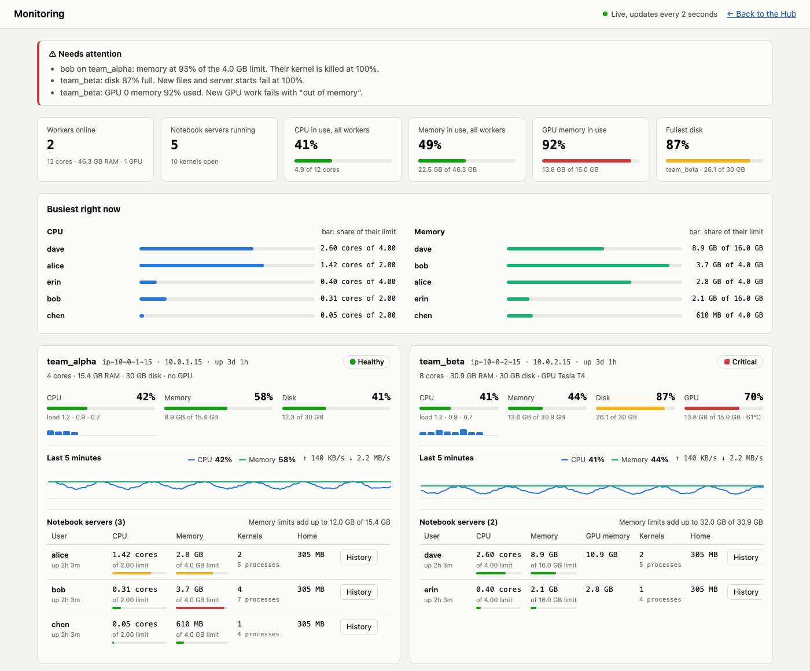
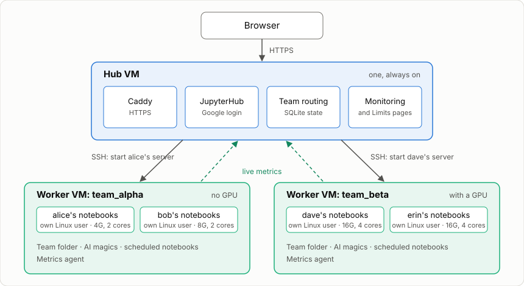
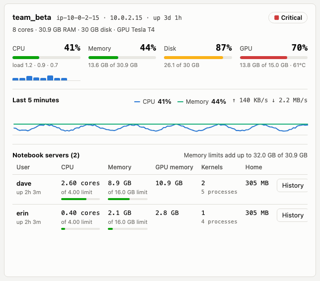
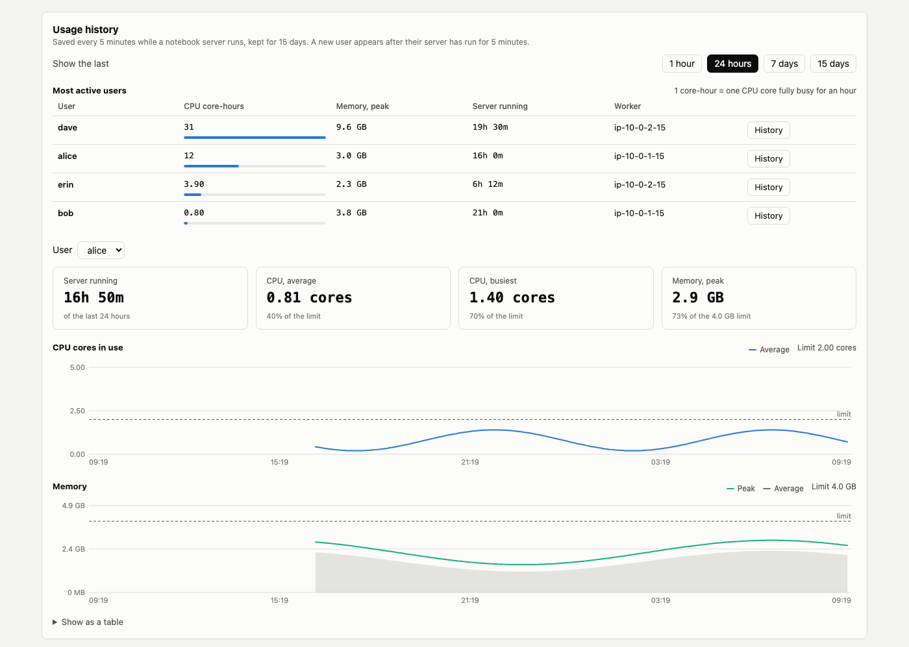
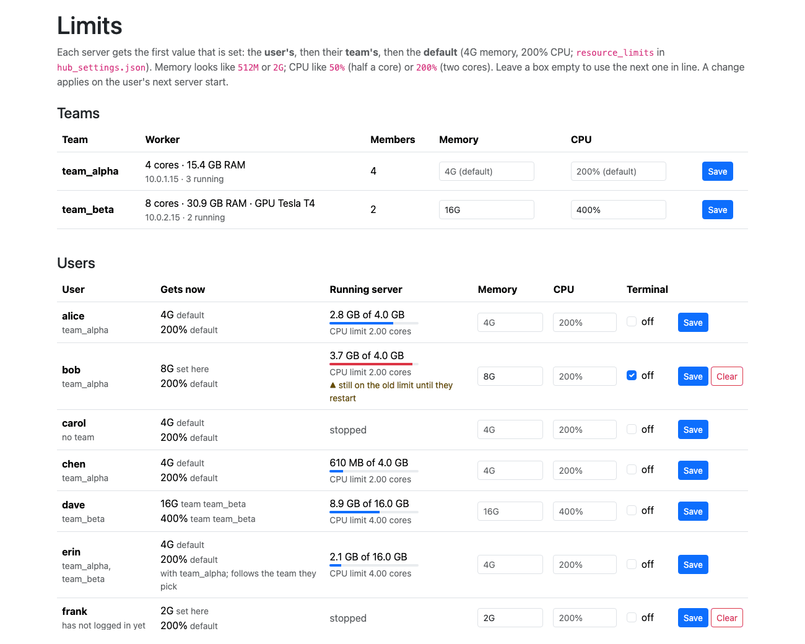
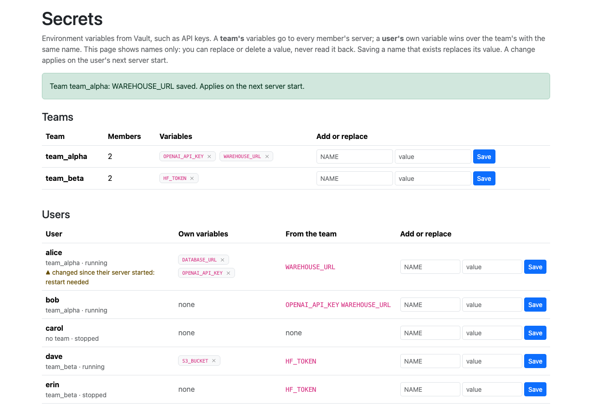
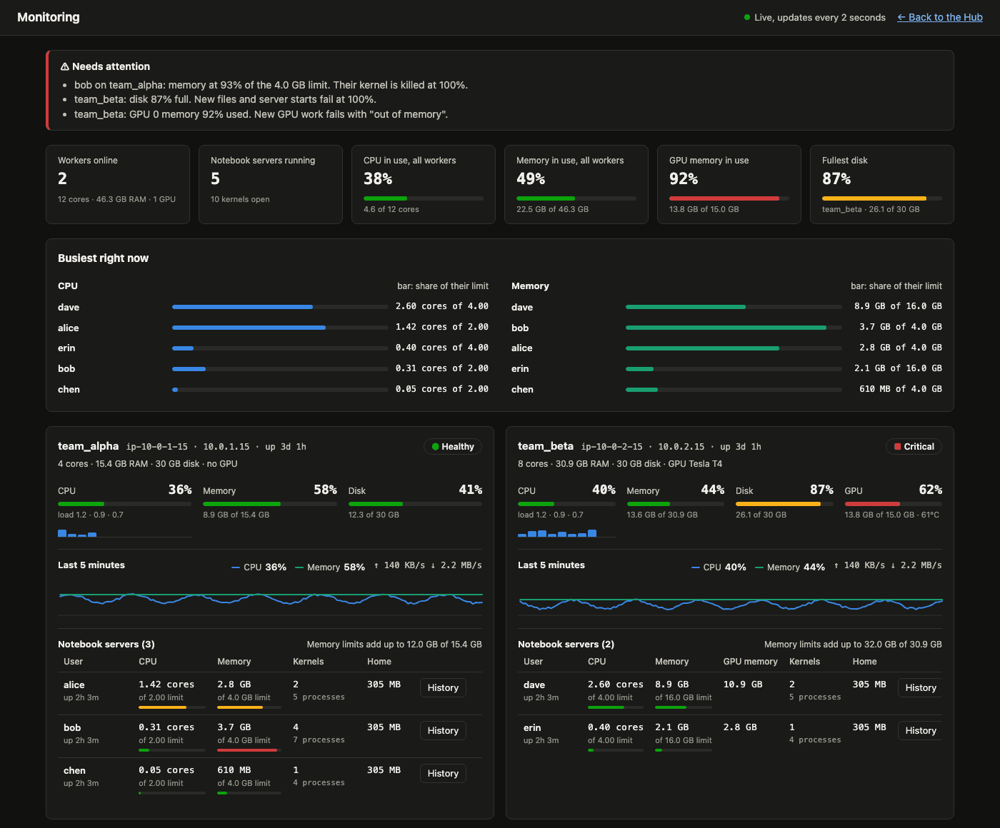
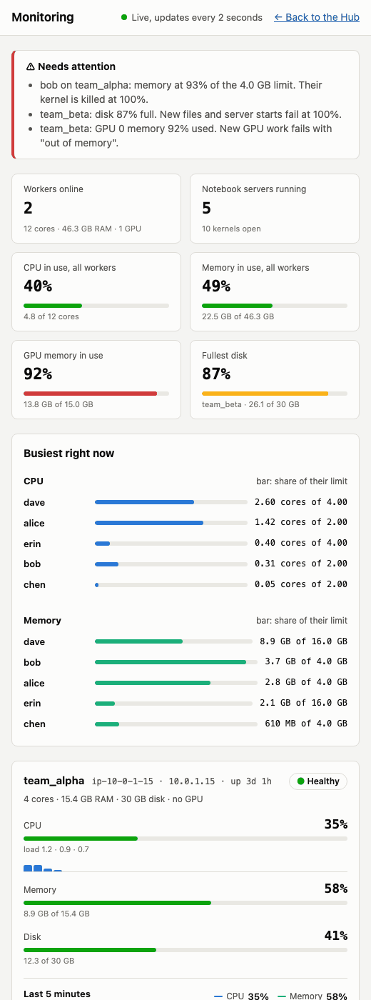

# JupyterHub-Pilot

One JupyterHub for many teams. Each team gets its own worker VM, every user gets their own limits, and every notebook has an AI assistant.

[](https://pypi.org/project/jupyterhub-pilot/)
[](https://pypi.org/project/jupyterhub-pilot/)
[](LICENSE)



## What you get

- **A worker VM per team.** One heavy team cannot slow down another.
- **A Linux account and a RAM/CPU limit per user.** A notebook over its limit is stopped; nobody else notices.
- **Any worker size, with or without a GPU.** The GPU is found automatically.
- **Live monitoring and 15 days of usage history**, per worker and per user.
- **AI magics in every notebook:** `%do`, `%fix`, `%review`, `%rework`, `%explain`.
- **For analysts:** team folders, scheduled notebooks, Git, a terminal, the same data packages on every worker.
- **One command per machine** to install, and one to upgrade.

Every feature, and which ones are tested on real machines: [Features](docs/FEATURES.md).

## How it works



A user logs in to the Hub and clicks **Start My Server**. The Hub finds their team's worker, creates their Linux account there if needed, and starts their notebook server under their RAM and CPU limit.

## Quick start

You need two Ubuntu VMs (24.04 or 26.04) on the same private network: one Hub and one worker. Check ports, disk size and Google login first: [Before you start](docs/ADMIN.md#before-you-start).

**1. On the Hub VM**

```bash
sudo apt update && sudo apt install -y python3-pip
sudo pip3 install --break-system-packages --ignore-installed "jupyterhub-pilot[hub]"
sudo jupyterhub-pilot install-hub
```

It prints an SSH key and an agent token. Keep both for the worker.

**2. On the worker VM**

```bash
sudo apt update && sudo apt install -y python3-pip
sudo pip3 install --break-system-packages --ignore-installed "jupyterhub-pilot[worker,ai]"
sudo jupyterhub-pilot install-worker
```

**3. Back on the Hub**

```bash
sudo nano /etc/jupyterhub-pilot/hub.env      # Google client, or test passwords
sudo systemctl enable --now jupyterhub
```

Then put Caddy in front for HTTPS and create the team's group in **Admin → Groups**. The full walkthrough, including HTTPS and a test login without Google: [Install](docs/ADMIN.md#install-hub-and-first-worker), or [step by step on AWS](AWS_EC2_DEPLOYMENT.md).

## What it looks like

Example data: two teams, one worker with a GPU and one without.

**A worker's card.** Its size, each CPU core, the GPU, and every user against their own limit. Amber and red appear only when something is nearly full.



**Usage history.** Who used the most in the last hour, day, week or 15 days, and one user's CPU and memory with their limit drawn in.



**Limits.** Each team's and each user's RAM and CPU limit, where it comes from, and what their running server uses now.



**Secrets** (from 0.8.0, needs Vault). API keys and passwords for a team or a user, set in the browser and given to their notebooks as environment variables. The page shows names only, never values.



**Dark mode and phones.** The monitoring page follows the browser's setting and fits a narrow screen.

<p>


</p>

## In a notebook

```python
%load_ext jupyterhub_pilot.extension
%do load data/sales.csv and plot monthly revenue
```

`%do` writes the code into the next cell for you to check and run. It knows the columns of the DataFrames you have loaded.

| Magic | What it does |
|---|---|
| `%do <instruction>` | Writes code for the instruction |
| `%fix` | Reads the last error and proposes fixed code |
| `%review` | Reviews recent cells for bugs |
| `%rework <instruction>` | Rewrites the last cell |
| `%explain [question]` | Explains the last result in plain words |
| `%schedule add daily report.ipynb` | Runs a notebook on a schedule |

It works with a local Ollama, OpenAI, Claude or Gemini: [AI magics](docs/AI_MAGICS.md).

## Guides

| I want to | Read |
|---|---|
| Install a cluster | [Admin guide → Install](docs/ADMIN.md#install-hub-and-first-worker) · [AWS walkthrough](AWS_EC2_DEPLOYMENT.md) |
| Add a team, a worker or a GPU worker | [Add more worker servers](docs/ADMIN.md#add-more-worker-servers) |
| Add, move or delete users | [Add users and teams](docs/ADMIN.md#add-users-and-teams) |
| Change RAM and CPU limits | [Limits](docs/ADMIN.md#change-the-per-user-ram-and-cpu-limit) |
| Start, stop, restart, upgrade | [Start, stop and restart](docs/ADMIN.md#start-stop-and-restart) · [Upgrading](docs/ADMIN.md#upgrading) |
| Share home folders between workers | [Shared home folders (EFS)](docs/ADMIN.md#shared-home-folders-efs) |
| Fix a problem | [Logs and troubleshooting](docs/ADMIN.md#logs-and-troubleshooting) |
| Check a new cluster works | [Test a cluster](docs/ADMIN.md#test-a-cluster) |
| Use the notebooks, terminal, team folder, Git | [Using the notebooks](docs/USING.md) |
| Understand the monitoring page, connect Grafana | [Monitoring](docs/MONITORING.md) |
| Know how users are kept apart, set up Vault | [Security](docs/SECURITY.md) |
| See the design | [Architecture](docs/ARCHITECTURE.md) |
| Work on the code | [Development](docs/DEVELOPMENT.md) · [Tests](tests/README.md) |

What changed in each release: [Changelog](CHANGELOG.md). MIT licensed.
